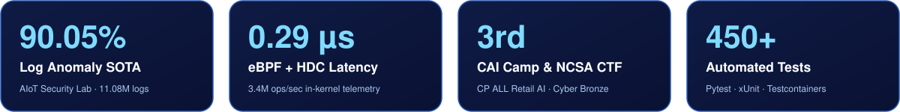
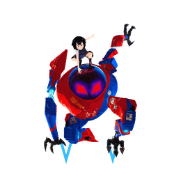
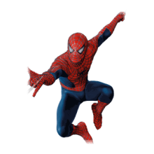
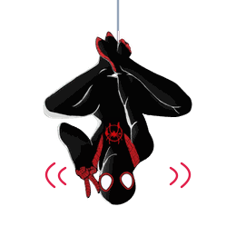
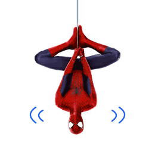

KMITL Dual Degree (IoT Engineering &amp; Industrial Physics) · AIoT Security Lab · Nexvia Core · 42 Bangkok · GDG on Campus KMITL

 

<h3>Research</h3>

<table>
<tr>
<td align="center" width="50%" valign="top">
 
<b>DeepLog HDFS Anomaly Detection</b> 
11.08M logs · 90.05% Top-1 acc · 0.29 µs eBPF + HDC 
99.99% audit recall · 293 tests · <a href="https://github.com/Chalermsak1/DeepLog-HDFS-Anomaly-Detection">repo</a>
</td>
<td align="center" width="50%" valign="top">
 
<b>Nexvia Aegis</b> 
Physical AI &amp; evidence-aware autonomous control 
MuJoCo 3D · Control Barrier Functions · ROS 2 · <a href="https://github.com/Chalermsak1/nexvia-aegis">repo</a>
</td>
</tr>
</table>

<h3>Featured projects</h3>

<table>
<tr>
<td align="center" width="33%" valign="top">
 
<b>IoT Network Sentinel</b> 
Two-stage Autoencoder + XGBoost IDS 
6× faster · 0.013% FPR · <a href="https://github.com/Chalermsak1/iot-network-sentinel">repo</a>
</td>
<td align="center" width="33%" valign="top">
 
<b>TraceHound AI</b> 
Explainable SOC log intelligence 
Temporal alert correlation · <a href="https://github.com/Chalermsak1/-TraceHound-AI">repo</a>
</td>
<td align="center" width="33%" valign="top">
 
<b>FloodTrace</b> 
Geospatial flood intelligence 
FastAPI · PostGIS · 76 tests · <a href="https://github.com/Chalermsak1/FloodTrace">repo</a>
</td>
</tr>
<tr>
<td align="center" width="33%" valign="top">
 
<b>ThaiKOL AI</b> 
Multilingual creator discovery 
Sentence Transformers · <a href="https://github.com/Chalermsak1/Thaikol-ai">repo</a>
</td>
<td align="center" width="33%" valign="top">
 
<b>Olist ELT Data Platform</b> 
Airflow, dbt &amp; PostgreSQL warehouse 
63 CI data quality tests · <a href="https://github.com/Chalermsak1/postgres-dbt-airflow-pipeline">repo</a>
</td>
<td align="center" width="33%" valign="top">
 
<b>SlipBloom</b> 
Zero-dependency Thai slip OCR 
Node.js · SQLite WAL · <a href="https://github.com/Chalermsak1/SlipBloom.">repo</a>
</td>
</tr>
<tr>
<td align="center" width="33%" valign="top">
 
<b>Support &amp; SQL Platform</b> 
Incident diagnostics &amp; EXPLAIN ANALYZE 
ASP.NET Core · Playwright · <a href="https://github.com/Chalermsak1/software-support-sql-platform">repo</a>
</td>
<td align="center" width="33%" valign="top">
 
<b>KMITL Flood Intelligence</b> 
Real-time flood incident telemetry 
FastAPI · Next.js · SSE · <a href="https://github.com/Chalermsak1/KMITL-Flood-Intelligence-">repo</a>
</td>
<td align="center" width="33%" valign="top">
 
<b>Smart IoT Climate Control</b> 
ESP32 sensor automation &amp; dashboard 
ESP32 · TypeScript · <a href="https://github.com/Chalermsak1/CIRCUITS-AND-IOT">repo</a>
</td>
</tr>
</table>

<h3>Tech stack</h3>

<h3>Engineering stats</h3>

  

<picture>
  <source media="(prefers-color-scheme: dark)" srcset="profile/github-snake-dark.svg" />
  <source media="(prefers-color-scheme: light)" srcset="profile/github-snake.svg" />
  
</picture>

